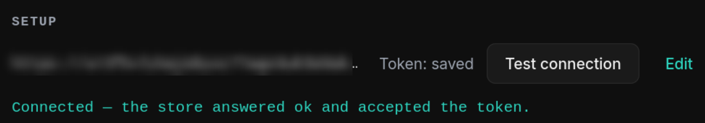
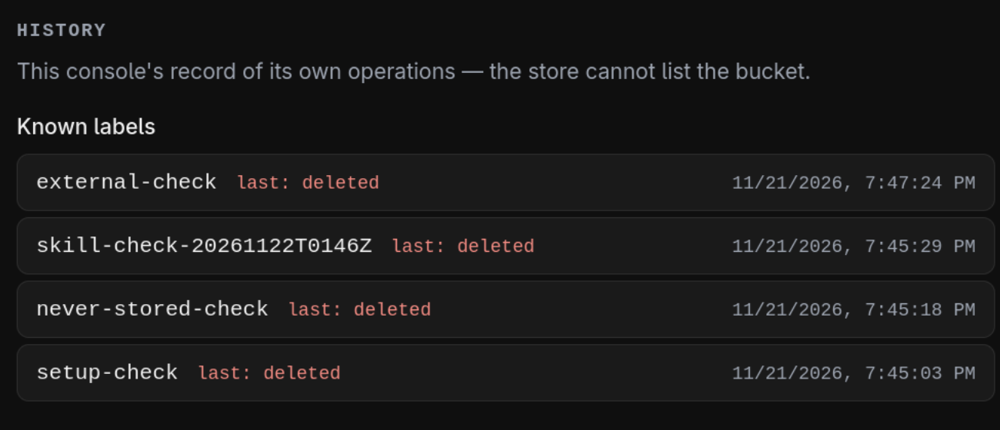

# Setting up the console

From this repository to a working console in Muse, in four steps:
install the Space, configure it, check it, and know how the token is
kept. You don't need to read the source.

## Before you start

You need:

- **Muse.** The browser check in step 3 needs Muse on the web, in a
  desktop browser. On a phone you can do everything else.
- **A deployed [s3-blob-store](https://github.com/cmeans/s3-blob-store).**
  From its deploy you need two things:
  - its **Function URL**, the deploy's Function URL output: an
    `https://` address ending in `.lambda-url.<region>.on.aws/`;
  - its **bearer token**: the plaintext token, 64 hex characters, that
    you generated for the deploy and saved in your password manager.
    Not its SHA-256 digest, which is also 64 hex characters: the deploy
    gives AWS only the digest, and the console needs the token itself.

Keep the token out of the chat: you'll paste it only into the
console's token field. The console then keeps its own copy (step 4).

## 1. Install the Space

Muse builds Spaces from source when you ask it to. In a chat with
Muse, say:

> Build me a Space from https://github.com/cmeans/s3-blob-store-muse

Muse fetches the repository, installs its dependencies and builds it.
The console then shows up with your other Spaces. You run nothing on
your own machine.

Don't edit two things in the tree, even if you fork it:

- `platformVersion` in `space.json`: Muse's builder writes it to record
  which Space runtime the app was built for.
- the `file:` path for `@hatch/space-sdk` in `package.json`: it points
  inside Muse's build environment, where the Space SDK ships. It isn't
  meant to resolve anywhere else.

And change `drizzle/meta/_journal.json` only by adding entries, as the
README's "How it works" describes: drizzle's migrator applies only the
migrations it lists.

## 2. Configure it

Open the console. With nothing saved yet, the **Setup** section shows
two fields:

1. **Function URL:** your store's Function URL. It must start with
   `https://`. A trailing slash doesn't matter.
2. **Bearer token:** paste the token. The field is a password field.

Then select **Save**, or **Test connection**, which saves first and
then tests.

After saving, the token field is cleared, and the section shows your
Function URL and **Token: saved**. To change either one later, select
**Edit**. The token field then stays empty, with the hint "Saved —
enter a new token to replace it". Leave it empty only if you're
canceling: saving needs both fields.

## 3. Check it

### Connection

Select **Test connection**. The console calls the store's health check
(`GET /`) with the saved token, and shows one of:

| Message | What it means |
|---|---|
| `Connected — the store answered ok and accepted the token.` | Working. |
| `Unauthorized (HTTP 401) — the store rejected the token.` | Wrong token: not the one this store was deployed with, or its SHA-256 digest instead of the token. Select **Edit** and paste it again. |
| `Forbidden (HTTP 403) — AWS refused the call before it reached the store. Check the deploy's Function URL permission, and that this is the store's URL.` | Not the token: a 403 comes from AWS before the store's code runs. Check the deploy and the URL: a Function URL that doesn't exist (a wrong id, or a deleted stack) also gives this. |
| `Unreachable — the Function URL did not answer. Check the URL and try again.` | The host doesn't exist (a typo outside the function id, or the wrong region), or the network failed. Check the URL against your deployment's output. |
| `No store configured — save the Function URL and token first.` | Nothing is saved yet. Fill in both fields first. |
| `Unexpected answer from the store (HTTP …).` | The address answered with another status: a store error, or a URL that points at something else. |

Saved and tested, it looks like this (the Function URL blurred):

### One round trip

Use test text, not a secret.

1. In **Blob**, enter the label `setup-check` and select **Fetch**.
   Expect `Not found — no blob under "setup-check".` If the text box
   fills in instead (`Fetched … characters.`), that label is in use:
   don't store or delete under it. Pick another, such as
   `setup-check-2`, and use it below, in place of `setup-check` in the
   messages too. Any other message is an error: stop, and check the
   connection first. Labels are up to 128 letters, digits, dots, dashes
   and underscores, and start with a letter or digit.
2. Clear the text box, then type a line of test text, for example
   `round trip test`, without pressing Enter (a newline counts as a
   character), and select **Store**. Expect
   `Stored 15 characters under "setup-check".`
3. Clear the text box and select **Fetch**. Your text comes back, and
   the message says `Fetched 15 characters.`
4. Select **Delete**, then **Confirm delete — irreversible**. Expect
   `The store answered deleted for "setup-check" (it says so even if nothing was stored there).`
5. Select **Fetch** again. Expect
   `Not found — no blob under "setup-check".` This proves the delete:
   the store also answers "deleted" for a label that was already gone.

The **History** section now lists the three operations, and
`setup-check` under known labels, with `last: deleted`. (If the first
label was in use, History also shows that fetch.) In the verification
run below, which used more test labels, it looked like this:

### The browser never receives the token

This needs Muse on the web, in a desktop browser with developer tools.

1. Open the console, then the developer tools' **Network** tab, and
   reload the page.
2. Select **Test connection**, then **Fetch** any label.
3. Look at the console's requests (Muse's own page may make others):
   - they go to the Space's own `actions` endpoint;
   - none goes to the store's address (`….lambda-url.….on.aws`): the
     Space's server calls the store, not your browser;
   - no response contains the token. The setup state reports only the
     Function URL and whether a token is saved.

The one request that does carry the token is the save, from your
browser to the Space's own server: **Save**, or **Test connection**
with new values in the form. It never comes back.

On a phone, without developer tools, the check you have is the one in
step 2: once saved, the token is never shown again.

## 4. How the token is kept

- It's stored in the Space's own server-side database, in a one-row
  `config` table beside the Function URL. That database belongs to
  this Space alone, and is never committed to the repository.
- Every call to the store is made by the Space's server, which adds
  the token as an `Authorization: Bearer` header at that moment.
- No server action returns it. `getConfigState` reports the Function
  URL and whether a token is saved, and nothing else.

This is a weaker posture than your agent's own connection to the
store, where the token stays in Muse's credential store and is added
to each request on its way out. The README's "Security, honestly"
section explains the trade-off.

## Changing the token

When you rotate the store's token (by redeploying it, as the store's
docs describe), the old token stops working: **Test connection** then
says Unauthorized. Select **Edit**, paste the new token, **Save**, and
test again.

## Letting the agent log its own operations

The console records only what it does itself. When your agent stores,
fetches or deletes a blob through its own connection, ask it to log
the operation with the console's `registerExternalOperation` action:
the label, the action (`stored`, `fetched` or `deleted`), and
optionally the size. It writes to the console's history only and
never contacts the store.

## Verified

The console was verified live against a store deployed with Terraform
on 2026-11-20: connection check and round trip by label.

On 2026-11-21 (US Central; the 22nd in UTC, as the test label in the
screenshot shows) it was verified end to end against a scratch store
deployed with the store's CloudFormation flow, from its v0.1.0 release
files ([#5](https://github.com/cmeans/s3-blob-store-muse/issues/5),
run by Muse with the maintainer). Every check passed:

| Check | Result |
|---|---|
| Step 1: build the Space from this repository's URL | Worked as written. The build created the `config` and `history` tables: the setup saved, and History loaded. |
| Step 2: configure, then **Test connection** | `Connected — the store answered ok and accepted the token.` The saved URL matched the deploy's output exactly. |
| Step 3: the round trip with `setup-check` | Every message as this guide gives it, ending with the 404 fetch that proves the delete. |
| Step 3: the browser check, in Firefox's Network tab | No request went to the store's address, and no response the maintainer inspected contained the token. |
| A wrong URL: a Function URL id that doesn't exist | `Forbidden (HTTP 403) — AWS refused the call before it reached the store. Check the deploy's Function URL permission, and that this is the store's URL.` |
| Deleting a label that was never stored | `The store answered deleted for "never-stored-check" (it says so even if nothing was stored there).` |
| The agent logging its own operation | Muse stored a blob through its own connection and logged it with `registerExternalOperation`, and it appeared in History. |
| The agent calling the console's actions | Muse called each action itself except `saveConfig`, which the user runs on the page, so the token never passes through the agent ([SKILL.md](SKILL.md)). |
| SKILL.md, end to end | Followed with a unique test label, every step as written but one retry (below). |

One `fetchBlob` during the run returned
`Unreachable — the store did not answer.` once; an immediate retry
worked, and it didn't happen again. SKILL.md now says to retry an
Unreachable once before stopping.
